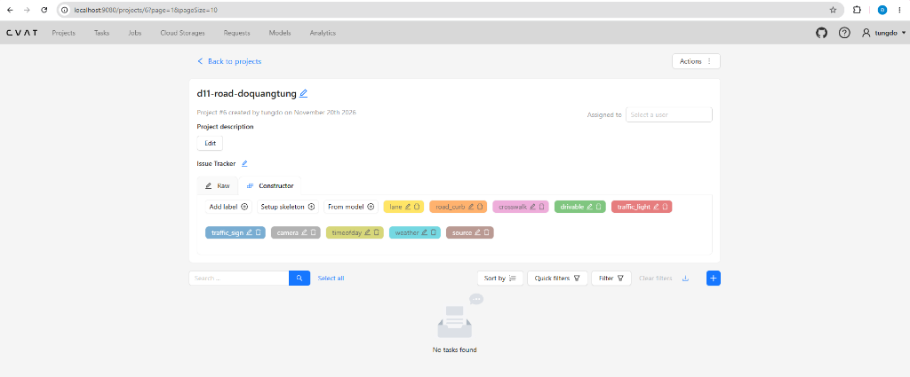
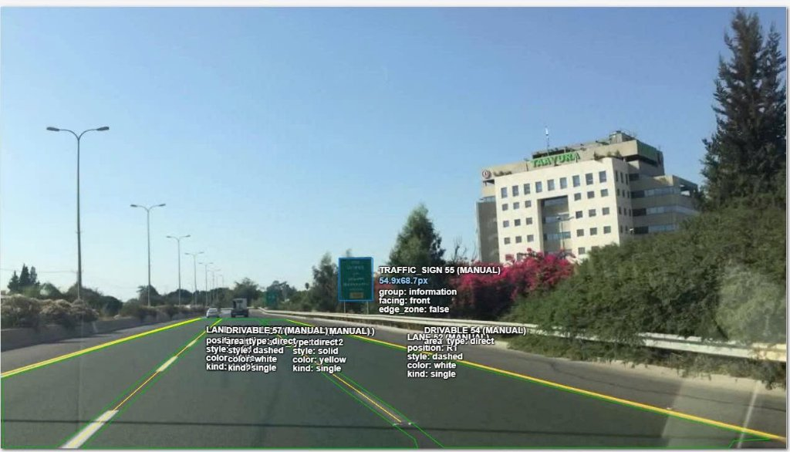
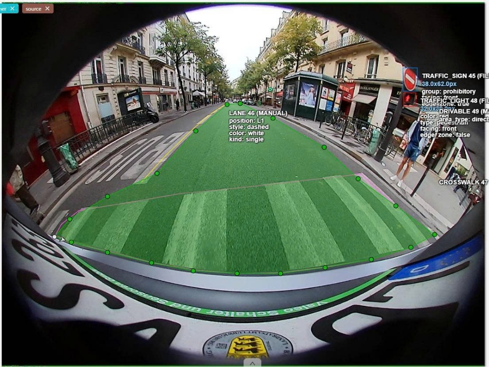

# Báo cáo cá nhân — Ngày 11

Họ tên: Đỗ Quang Tùng               Mã học viên: `2A202603108`  
Phiên bản CVAT (Help → About): Server `2.81.0` / UI `2.81.0` (CVAT local)  
Guideline: Road v1.0    Lần nộp (`revision` trong manifest): `1`  
Thời điểm export (ngày giờ trên CVAT): 2026-11-21 11:12 (UTC+7)    Số lần nộp lại sau Rework: `0` *(cập nhật lên `1` nếu có export lại revision 2 sau khi sửa phiếu QC của bạn Khánh)*  

## 1. Kiểm project
| Mục | Đúng như guideline Road v1.0? | Ghi chú |
| --- | --- | --- |
| 6 label, đúng kiểu | Đúng | Dán từ `configs/road_v1_labels.json` (`lane` polyline, `road_curb` polyline, `crosswalk` polygon, `drivable` polygon, `traffic_light` rectangle, `traffic_sign` rectangle). |
| Thuộc tính và giá trị | Đúng | Khớp hoàn toàn với `src/road_lab/taxonomy.py`, kiểm qua tab Constructor. |
| 4 tag ảnh | Đúng | Đủ 4 label kiểu Tag (`camera`, `timeofday`, `weather`, `source`), mỗi tag có thuộc tính select `value`. |

Cách kết thúc polyline trên bản CVAT này: Bấm phím **`N`** (hoặc bấm nút *Done* trên thanh trên cùng) sau khi chấm điểm cuối.  
Cách đặt tag ảnh trên bản CVAT này: Chọn công cụ **Tag** (thanh công cụ bên trái) → chọn từng label `camera`, `timeofday`, `weather`, `source` → bấm *Add tag* → mở **Details** trong bảng Objects bên phải để kiểm và đổi giá trị `value` khỏi mặc định.  

## 2. Số lượng đã gán
| Task | Ảnh | lane | road_curb | crosswalk | drivable | traffic_light | traffic_sign |
| --- | ---: | ---: | ---: | ---: | ---: | ---: | ---: |
| front | 12 | 33 | 6 | 7 | 24 | 31 | 21 |
| front-extra (đã làm 0 / 4) | 0 | 0 | 0 | 0 | 0 | 0 | 0 |
| fisheye | 8 | 5 | 1 | 8 | 4 | 4 | 3 |
| fisheye-extra (đã làm 0 / 4) | 0 | 0 | 0 | 0 | 0 | 0 | 0 |

## 3. Bảng ca khó
| Ảnh | Nhãn | Phân vân giữa | Đã chọn | Lý do |
| --- | --- | --- | --- | --- |
| A03 | `lane` (`L1`) | `kind = single` hay `double` ở dải phân cách kẻ chéo vàng bên trái | `double` (và tách rõ vạch sát xe nhất là `L1`) | Vạch sơn tim đường bên trái có hai nét vàng song song phân chia chiều xe chạy; ghi nhận phản hồi từ bạn Khánh để giữ đúng 1 đường `L1`. |
| A05 | `lane` | Có nên vẽ `L1`/`R1` hay để trống vì `lint` báo `QC1-02` | Không vẽ `lane`, chỉ vẽ `road_curb` và `drivable` | Thực tế mặt đường ở `A05` hoàn toàn không có vạch sơn kẻ làn; tuân thủ đúng quy tắc mục 6 hướng dẫn CVAT (không vẽ vạch mà ảnh không có). |
| A08 | `traffic_sign` | Gộp biển *"PASSENGER CARS ONLY"* chung với biển xanh lá hay tách riêng | Tách hộp riêng `group = supplementary` | Theo guideline Road v1.0 mục 3, biển phụ đi kèm biển chính phải có hộp riêng với `group = supplementary`. |
| B03 | `lane` / `road_curb` | Mép đảo gạch bên trái gán `lane` hay `road_curb` | `road_curb` | Mép đường bên trái là gờ vỉa/đảo gạch không có vạch sơn nên gán `road_curb` theo cung cong nhiều điểm. |

## 4. Phiếu QC 1 nhận được
Bạn kiểm lô của tôi: Nguyễn Quốc Khánh (`2A202603238`)  Quyết định nhận được: **Rework**  

| Mã lỗi | Số lỗi | Đồng ý? | Đã sửa? |
| --- | ---: | --- | --- |
| QC1-02 (thiếu `R1` ở B04) | 1 | Một phần (B04 phía bên phải là vỉa hè/lề đường, cần kiểm lại xem có vạch sơn hay gán `road_curb`) | Đang rà soát trước khi chốt revision 2 |
| QC1-03 (trùng `L1` ở A03; thừa `lane` ở B07) | 2 | Đồng ý (A03 đã sửa không còn trùng `L1` trên bản export mới; B07 sẽ kiểm lại vạch xe đạp) | Đã sửa A03; B07 rà soát ở revision 2 |
| QC1-05 (tách vạch ở A01, A04) | 3 | Đồng ý | Đã sửa sạch cảnh báo `QC1-05` trên `doquangtung-front.zip` (0 lỗi chính khi chạy `road_check lint`) |
| QC1-07 (thiếu `road_curb` ở B07) | 1 | Đồng ý | Sẽ bổ sung `road_curb` theo cung ở B07 nếu làm revision 2 |
| QC1-09 (biển phụ ở A08) | 1 | Đồng ý | Đã kiểm và tách biển phụ ở A08 |
| QC1-11 (ít điểm cong ở B04) | 1 | Không đồng ý ở bản export hiện tại | Đã vẽ 7 điểm cong cho `lane` và 11 điểm cho `crosswalk`/`drivable` trên B04 (0 cảnh báo `QC1-11` khi chạy `lint`) |

## 5. Kiểm file export
| File | Mở lại được? | Số shape ảnh 1 (job / file) | Số shape ảnh 2 (job / file) | Tag camera có trong XML? |
| --- | --- | --- | --- | --- |
| `doquangtung-front.zip` | Có (`road_check lint` đọc bình thường, `contains_images = false`) | 9 / 9 (`A01`) | 6 / 6 (`A02`) | Có (`camera=front` trên đủ 12/12 ảnh) |
| `doquangtung-fisheye.zip` | Có (`road_check lint` đọc bình thường, `contains_images = false`) | 3 / 3 (`B01`) | 4 / 4 (`B02`) | Có (`fisheye_front/rear/left/right` trên đủ 8/8 ảnh) |

## 6. Ảnh chụp màn hình
1. Tab Labels của project: 
2. Một ảnh camera trước đã gán đủ (làn, vùng lái, đèn/biển): 
3. Một ảnh fisheye đã gán, phóng to đoạn polyline cong: 
4. Một đoạn XML có `<polyline label="lane">` (trích trực tiếp từ `doquangtung-front.zip` — `annotations.xml`):
```xml
<polyline label="lane" source="manual" occluded="0" points="3.02,603.03;63.99,584.05;123.93,566.24;160.49,555.13;229.10,534.88;292.85,517.18;325.02,508.38" z_order="0">
  <attribute name="position">L2</attribute>
  <attribute name="style">solid</attribute>
  <attribute name="color">white</attribute>
  <attribute name="kind">double</attribute>
</polyline>
```

## 7. Tự đánh giá
- Lỗi bạn mắc nhiều nhất hôm nay (theo mã QC1-xx), và cách tránh ở Ngày 20: lỗi QC1-05 / QC1-03 do quên sửa giá trị mặc định L1 trong Details của CVAT và QC1-02 thiếu R1; cách tránh ở Ngày 20 là mở Details kiểm ngay sau mỗi nét vẽ và chạy road_check lint trước khi Finish job.
- Nhãn của bạn đi vào model ở đâu? Chọn một lỗi đã sửa và nói nó làm model học sai thế nào: polyline lane là đích huấn luyện cho model phát hiện làn đường / giữ làn (LKA); nếu gán nhầm position giữa L1 và R1 (hoặc tách vạch đứt làm hai), model sẽ dự đoán sai ranh giới làn xe đang đi và khiến hệ thống LKA đánh lái lệch làn.
